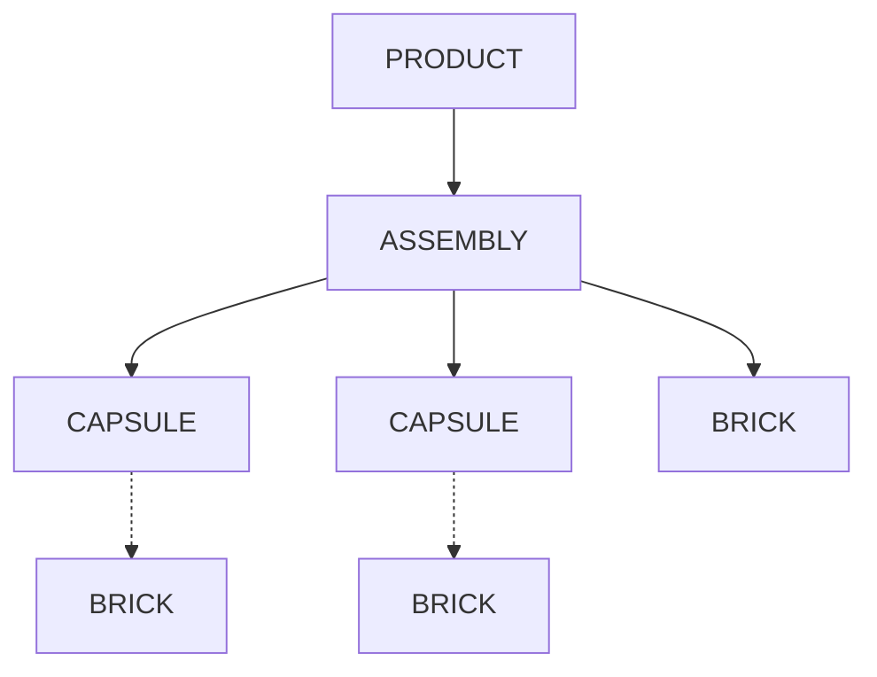
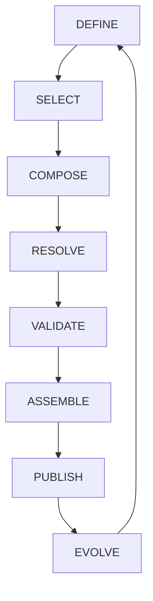
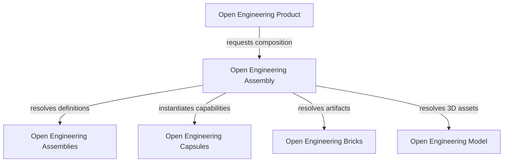
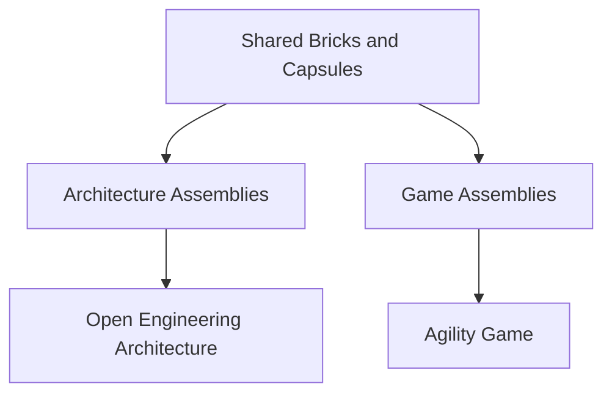

# Open Engineering Product

**Assemble software. Compose capabilities. Deliver products.**

Welcome to **Open Engineering Product**, the Open Engineering organization dedicated to defining what constitutes a software product, how products are composed from reusable capabilities, and how they are versioned, validated, released and evolved.

Open Engineering introduces a fundamental change in how we approach software development:

> We do not merely build software products. We assemble them from independently defined, reusable and interoperable components.

Inspired by the LEGO System, Open Engineering treats software products as compositions of standardized digital building blocks rather than monolithic implementations.

The analogy is architectural, not literal. Our bricks are software artifacts, architectural knowledge, configurations and contracts—not physical objects.

---

## 1. Our Vision

**A product is an assembled, executable and independently identifiable outcome of reusable software capabilities.**

Traditional software development frequently organizes applications around individual projects, repositories and technology stacks.

Open Engineering introduces a compositional approach in which capabilities can be independently developed, validated, versioned, discovered and reused across multiple products.

The objective is to create a small, coherent and interoperable collection of components capable of producing many different software products.

Our guiding principle is:

> Define independently. Connect through contracts. Assemble declaratively. Execute consistently.

Open Engineering Product establishes the product-level contracts and lifecycle that make this approach practical.

---

## 2. The Open Engineering Composition Model

Open Engineering distinguishes four fundamental architectural concepts.

| Concept | Responsibility |
|---|---|
| **Brick** | An independently identifiable and reusable unit of information, configuration, assets or contracts |
| **Capsule** | An encapsulated software capability providing behavior through explicit interfaces |
| **Assembly** | A declarative composition of bricks, capsules and potentially other assemblies |
| **Product** | A complete software application or experience realized from one or more assemblies |

The relationship is illustrated below.



This diagram represents conceptual composition, not mandatory physical containment.

Bricks and capsules may be shared between assemblies. Assemblies may reference other assemblies. Products may reuse the same underlying capabilities while providing entirely different user experiences.

### 2.1 Bricks

Bricks represent reusable architectural and software artifacts.

Examples include:

- Architecture elements and relationships
- Architecture Decision Records
- Specifications and assessments
- Scenarios and mission definitions
- Scene and camera configurations
- GLB model references
- Interaction and integration contracts

Bricks have stable identities, versioned contracts and independently validated specifications.

### 2.2 Capsules

Capsules encapsulate reusable behavior.

Examples include:

- Architecture Model Capsule
- Architecture Knowledge Capsule
- Scenario Capsule
- Mission Capsule
- Scene Capsule
- Navigation Capsule
- Inspection Capsule

Capsules declare the capabilities they provide and require.

They expose explicit interfaces and predictable lifecycles.

A capsule does not necessarily represent a separately deployed service. Multiple capsules may execute within the same application.

### 2.3 Assemblies

Assemblies describe how reusable components cooperate.

Examples include:

- Architecture Documentation Assembly
- Architecture Visualization Assembly
- Architecture Investigation Assembly
- Game Board Assembly
- Simulation Assembly
- Interactive Narration Assembly

Assemblies are preferably defined through declarative, versioned manifests.

### 2.4 Products

Products are the resulting applications or experiences.

A product combines one or more assemblies with product-specific configuration, identity, interaction, validation and delivery requirements.

Products are not required to own the implementations of their constituent capabilities.

Instead, they consume reusable capabilities through standardized contracts.

---

## 3. What Is an Open Engineering Product?

An Open Engineering Product is a versioned software deliverable whose composition, behavior and dependencies can be identified and reproduced.

A product should define:

| Property | Description |
|---|---|
| Identity | Unique product identifier and name |
| Description | Purpose, audience and intended outcome |
| Version | Product release version |
| Assemblies | Referenced assembly definitions |
| Configuration | Product-specific settings and bindings |
| Dependencies | Required artifacts and compatible versions |
| Interfaces | Exposed product capabilities and integrations |
| Runtime | Required execution environment |
| Validation | Product-level acceptance and compatibility criteria |
| Release | Immutable release metadata and artifacts |
| Provenance | Traceability to source components and build inputs |

The product contract is independent of any particular programming language, rendering engine or deployment platform.

### 3.1 Product Definition

The following YAML illustrates a proposed product manifest.

```yaml
apiVersion: openengineering.org/v1
kind: Product

metadata:
  name: open-engineering-architecture
  version: 1.0.0
  description: >
    Interactive exploration, documentation
    and investigation of software architecture.

spec:
  assemblies:
    - name: architecture-documentation
      version: "^1.0.0"

    - name: architecture-visualization
      version: "^1.0.0"

    - name: architecture-investigation
      version: "^1.0.0"

  configuration:
    architecture:
      source: likec4

    visualization:
      renderer: babylonjs

    interface:
      framework: sveltekit

  runtime:
    type: web

  validation:
    requireCompatibleContracts: true
    requireResolvedDependencies: true

  release:
    strategy: versioned
    generateLockfile: true
```

**Note:** This manifest is a proposed architectural contract, not an established or implemented Open Engineering specification.

Its schema, reference conventions and lifecycle semantics require formalization.

---

## 4. Product Versus Assembly

A distinction must be maintained between an assembly and a product.

An **assembly** defines how reusable components are connected.

A **product** gives those compositions an identifiable purpose, a user experience, operational requirements and a release lifecycle.

For example:

```text
Open Engineering Architecture
|
+-- Architecture Documentation Assembly
|
+-- Architecture Visualization Assembly
|
+-- Architecture Investigation Assembly
|
+-- Product Configuration
|
+-- Product Identity
|
+-- Product Validation
|
+-- Product Release
```

An assembly may be reusable across products.

A product represents a particular combination of capabilities delivered for a particular purpose.

Consequently:

> An assembly describes composition. A product delivers value.

---

## 5. Product Lifecycle

Open Engineering Product proposes a lifecycle consisting of eight stages.



### Define

Specify the product's purpose, identity, requirements and intended capabilities.

### Select

Discover and select compatible bricks, capsules and assemblies.

### Compose

Describe the product through declarative assembly and product manifests.

### Resolve

Resolve component dependencies, versions, contracts and required artifacts.

### Validate

Verify schema compliance, compatibility, architectural constraints and acceptance criteria.

### Assemble

Use Open Engineering Assembly to instantiate or produce the required composition.

### Publish

Create a versioned product release with reproducible artifacts and provenance.

### Evolve

Update, replace or extend capabilities while preserving product contracts and compatibility.

This lifecycle is a proposed target model. Its automation may be introduced incrementally.

---

## 6. Product Architecture

Open Engineering Product operates above the assembly layer.



The responsibilities are deliberately separated.

**Open Engineering Product** defines the product contract, composition requirements, validation expectations and release identity.

**Open Engineering Assemblies** defines reusable compositions and their schemas.

**Open Engineering Assembly** implements composition resolution and execution.

**Open Engineering Capsules** defines reusable behavioral capabilities.

**Open Engineering Bricks** defines reusable units and their contracts.

**Open Engineering Model** provides reusable 3D model assets, including GLB models derived from LDraw specifications.

Product-specific implementations consume these capabilities rather than duplicating them.

---

## 7. Products Assembled by Open Engineering

The Open Engineering approach is intended to support products with different purposes and user experiences.

### 7.1 Open Engineering Architecture

[Open Engineering Architecture](https://github.com/open-engineering-architecture)

An interactive environment for understanding, documenting, visualizing and investigating software architecture.

Potential assemblies include:

- Architecture Documentation
- Architecture Visualization
- Architecture Investigation
- Architecture Exploration

Potential technologies include LikeC4, SvelteKit, Babylon.js, Markdown and GLB/glTF.

The product can combine architecture models, decisions, specifications, scenarios, missions and interactive 3D representations.

### 7.2 Agility Game

[Agility Game](https://github.com/agility-game)

An interactive business simulation and learning experience that can use reusable Open Engineering capabilities.

Potential assemblies include:

- Game Board
- Player Interaction
- Simulation
- Scenario Management
- Visualization

Agility Game may reuse Scene, Navigation, Interaction and Scenario capabilities without inheriting architecture-specific domain behavior.

### 7.3 Future Products

The same composition model can support future products involving:

- Interactive simulations
- Architecture investigations
- Educational experiences
- Digital twins
- AI-assisted software engineering
- Interactive narrations
- Robotic and virtual experiences

Reuse is encouraged where contracts and behavior genuinely align.

The objective is not to force every product into identical internal structures.

---

## 8. Product Reuse

The value of composable architecture becomes visible when different products consume the same capabilities.



For example, both Open Engineering Architecture and Agility Game may use a reusable Scene Capsule.

The capsule manages scene creation, lifecycle and rendering adapters.

Each product supplies its own scene definitions, assets, interactions and domain-specific rules.

The result is shared implementation without sacrificing product identity.

---

## 9. Product Contracts and Reproducibility

A product should be reproducible from its declared composition.

To support this objective, Open Engineering Product proposes:

1. Versioned product manifests.
2. Versioned assembly references.
3. Stable brick and capsule identities.
4. Explicit capability contracts.
5. Dependency compatibility validation.
6. Deterministic dependency resolution.
7. Immutable artifact references.
8. Product lockfiles.
9. Automated product acceptance tests.
10. Traceable product releases.

### 9.1 Product Lockfile

A resolved product lockfile should capture:

- Product identity and version
- Resolved assemblies
- Resolved capsules
- Referenced bricks
- Artifact versions
- Content digests
- Dependency graph
- Contract and schema versions

A lockfile enables a product to be assembled again using the same resolved components.

### 9.2 Product Provenance

A product release should make it possible to determine:

- Which components were included
- Which versions were selected
- Which source artifacts were used
- Which validation checks passed
- Which assembly process produced the release

This creates traceability between product requirements, composition and delivered artifacts.

---

## 10. Product Quality

Composability must not compromise product quality.

Every product should satisfy a defined set of acceptance criteria.

| Quality Attribute | Expected Property |
|---|---|
| Correctness | The product satisfies its functional requirements |
| Compatibility | All required component contracts are compatible |
| Reproducibility | The product can be reproduced from resolved artifacts |
| Traceability | Product composition and provenance are identifiable |
| Maintainability | Components can evolve without unnecessary coupling |
| Testability | Assemblies and products can be validated independently |
| Interoperability | Components communicate through explicit contracts |
| Portability | Domain contracts avoid unnecessary platform dependencies |
| Security | Dependencies and integrations are subject to appropriate controls |
| Observability | Product lifecycle and runtime failures can be diagnosed |

Product acceptance tests complement, rather than replace, brick, capsule and assembly validation.

---

## 11. Product Evolution

Open Engineering products should evolve through composition wherever practical.

A new capability may be introduced by:

- Adding a brick
- Updating a brick definition
- Replacing a capsule implementation
- Selecting another compatible capsule
- Extending an assembly
- Reconfiguring an existing assembly
- Introducing a new assembly
- Publishing a new product version

This approach supports incremental change without requiring the entire product to be redesigned.

### Rule of Existing Gravity

Open Engineering follows the **Rule of Existing Gravity**.

Before introducing or replacing a capability:

1. Identify existing implementations.
2. Identify current consumers.
3. Inspect established contracts.
4. Evaluate dependencies and migration impact.
5. Preserve existing behavior through tests.
6. Prefer reuse and adapters over duplication.
7. Document architectural decisions.

The goal is deliberate evolution rather than unnecessary reinvention.

---

## 12. Definition and Implementation

Open Engineering distinguishes between reusable definitions and their implementations.

| Definition | Implementation |
|---|---|
| [Open Engineering Bricks](https://github.com/open-engineering-bricks) | [Open Engineering Brick](https://github.com/open-engineering-brick) |
| [Open Engineering Assemblies](https://github.com/open-engineering-assemblies) | [Open Engineering Assembly](https://github.com/open-engineering-assembly) |

**Open Engineering Product** is responsible for establishing the product-level concepts, contracts and conventions.

Individual products, such as Open Engineering Architecture and Agility Game, are implementations or realizations of those concepts.

This organization should not duplicate the responsibilities of Open Engineering Assembly.

Instead, it defines what a product requires and how its successful realization can be evaluated.

---

## 13. Proposed Repository Structure

The following structure is proposed for the Open Engineering Product source repository.

```text
source/
|
+-- README.md
|
+-- specification/
|   +-- product.md
|   +-- product-manifest.md
|   +-- product-lifecycle.md
|   +-- product-release.md
|
+-- schema/
|   +-- product.schema.json
|
+-- examples/
|   +-- architecture.product.yaml
|   +-- agility-game.product.yaml
|
+-- decisions/
|
+-- assessments/
|
+-- scenarios/
|
+-- tests/
|   +-- contract/
|   +-- compatibility/
|
+-- docs/
    +-- composition.md
    +-- reproducibility.md
    +-- provenance.md
```

This structure is illustrative and should be reconciled with existing repository conventions before adoption.

The repository should prioritize product definitions, schemas, examples and validation contracts.

Assembly execution belongs to Open Engineering Assembly.

---

## 14. Initial Implementation Roadmap

The recommended introduction is incremental.

### Phase 1 — Product Definition

- [ ] Define the canonical Product contract.
- [ ] Define product identity and versioning.
- [ ] Define the relationship between Product and Assembly.
- [ ] Establish product lifecycle states.
- [ ] Publish a versioned JSON Schema.

### Phase 2 — Product Manifests

- [ ] Define declarative product manifests.
- [ ] Reference reusable assemblies.
- [ ] Support product-specific configuration.
- [ ] Validate referenced capabilities.
- [ ] Define product dependency resolution requirements.

### Phase 3 — Product Resolution

- [ ] Integrate with Open Engineering Assembly.
- [ ] Resolve nested assembly dependencies.
- [ ] Validate version compatibility.
- [ ] Generate reproducible product lockfiles.
- [ ] Produce diagnostic reports.

### Phase 4 — Product Release

- [ ] Define product release artifacts.
- [ ] Establish product provenance.
- [ ] Introduce automated acceptance testing.
- [ ] Publish versioned releases.
- [ ] Document reproducible deployment procedures.

### Phase 5 — Cross-Product Validation

- [ ] Describe Open Engineering Architecture as a Product.
- [ ] Describe Agility Game as a Product.
- [ ] Demonstrate reuse of a shared Scene Capsule.
- [ ] Validate independent product configurations.
- [ ] Demonstrate component replacement without unnecessary product changes.

The initial proof of concept should focus on Open Engineering Architecture and its Architecture Exploration Assembly.

---

## 15. Architectural Principles

Open Engineering Product follows these principles.

**Composition over duplication**

Reuse existing capabilities before introducing new implementations.

**Contracts over coupling**

Connect components through explicit, versioned interfaces.

**Definitions over hardcoding**

Prefer declarative specifications to product-specific composition logic.

**Meaning over technology**

Keep domain concepts independent of rendering engines, frameworks and deployment mechanisms.

**Reproducibility over ambiguity**

Resolve versions and preserve immutable artifact identities.

**Evolution over reinvention**

Preserve existing behavior and migrate incrementally.

**Products over projects**

Organize reusable capabilities around durable product outcomes rather than isolated development efforts.

---

## 16. Related Open Engineering Organizations

| Organization | Responsibility |
|---|---|
| [Open Engineering Architecture](https://github.com/open-engineering-architecture) | Interactive architecture product |
| [Open Engineering Bricks](https://github.com/open-engineering-bricks) | Reusable brick definitions |
| [Open Engineering Brick](https://github.com/open-engineering-brick) | Brick implementation |
| [Open Engineering Capsules](https://github.com/open-engineering-capsules) | Reusable behavioral capabilities |
| [Open Engineering Assemblies](https://github.com/open-engineering-assemblies) | Declarative assembly definitions |
| [Open Engineering Assembly](https://github.com/open-engineering-assembly) | Assembly resolution and execution |
| [Open Engineering Model](https://github.com/open-engineering-model) | Reusable 3D model artifacts |
| [Agility Game](https://github.com/agility-game) | Interactive simulation product |

These organizations represent complementary responsibilities within the broader Open Engineering ecosystem.

---

## 17. References

### Open Engineering

- [Open Engineering Architecture](https://github.com/open-engineering-architecture)
- [Open Engineering Bricks](https://github.com/open-engineering-bricks)
- [Open Engineering Assemblies](https://github.com/open-engineering-assemblies)
- [Open Engineering Assembly](https://github.com/open-engineering-assembly)
- [Open Engineering Model](https://github.com/open-engineering-model)

### Architecture and Composition

- [C4 Model](https://c4model.com/)
- [LikeC4](https://likec4.dev/)
- [JSON Schema](https://json-schema.org/)
- [Semantic Versioning](https://semver.org/)
- [Open Container Initiative](https://opencontainers.org/)
- [Software Product Line Practice — SEI](https://www.sei.cmu.edu/library/a-framework-for-software-product-line-practice-version-5-0/)

### Visualization and Models

- [Babylon.js](https://www.babylonjs.com/)
- [glTF — Khronos Group](https://www.khronos.org/gltf/)
- [LDraw](https://www.ldraw.org/)

### Software Architecture

- [Martin Fowler — Patterns of Enterprise Application Architecture](https://martinfowler.com/books/eaa.html)
- [Martin Fowler — Microservices](https://martinfowler.com/articles/microservices.html)

---

## 18. Our Mission

Open Engineering Product exists to make software products composable, reproducible, interoperable and capable of evolving through reusable capabilities.

We aim to move beyond applications that are repeatedly built from scratch toward products assembled from standardized digital building blocks.

The measure of success is not the number of bricks, capsules or assemblies created.

It is the number of useful products that can be realized, adapted and maintained without unnecessary duplication.

> **Bricks define. Capsules enable. Assemblies compose. Products deliver.**

**Open Engineering — From building software to assembling products.**

